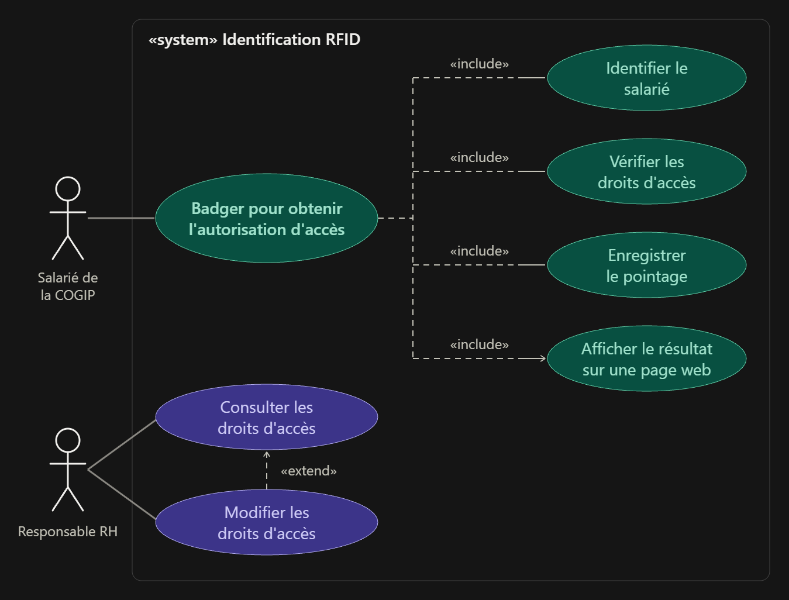
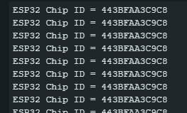
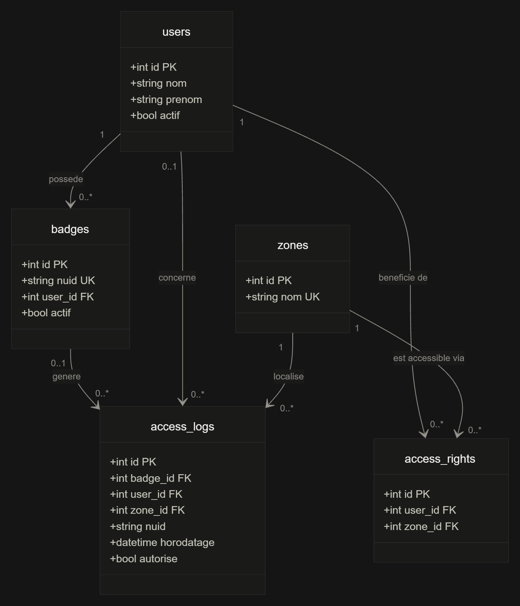

**Q1** Les 3 principaux inconvéniants sont :
- horrible quand il y a trop d'employés
- la réparation de celle-ci comparé à un capteur 
- les donnée ne sont pas stocké sur le réseau 

**Q2** 

**Q3**

Si la vitesse est différente à 115200 baud pour cette carte, les informations ne vont pas pouvoir être lu par le logiciel arduino

**Q4**
digitalWrite(2, HIGH); Cette instruction envoie un niveau logique haut (état HIGH, soit une tension d'environ 3,3 Volts) sur la broche 2. Cela allume la Led bleue.

digitalWrite(2, LOW); Cette instruction envoie un niveau logique bas (état LOW, soit 0 Volt) sur la broche 2. Cela coupe l'alimentation de la broche et éteint la LED.

pinMode(2, OUTPUT); Cette instruction configure la broche physique numéro 2 (GPIO 2) de l'ESP32 en mode sortie (OUTPUT). Cela indique au microcontrôleur qu'il va envoyer un signal électrique vers la LED intégrée connectée à cette broche.

uint64_t chipid; crée une variable entière non signée sur 64 bits pour stocker un identifiant unique matériel ou une adresse MAC

**Q5**

SCK (Serial Clock) : Signal d'horloge généré par le maître pour synchroniser les transferts de données sur le bus.   
MOSI (Master Out Slave In) : Ligne de communication dédiée à l'envoi de données du maître vers l'esclave.   
MISO (Master In Slave Out) : Ligne de communication dédiée à l'envoi de données de l'esclave vers le maître.   
NSS  : Signal de sélection d'esclave (actif à l'état bas) qui permet au maître de choisir quel périphérique il souhaite contacter

**Q6** 
Le bus SPI fonctionne en full-duplex, ce qui signifie que les données peuvent être transmises et reçues simultanément dans les deux sens grâce aux lignes séparées MOSI et MISO.

Le maître utilise les 3 broches communes (SCK, MOSI, MISO) plus une broche NSS séparée pour chaque esclave. Pour connecter deux esclaves, le maître a donc besoin de 5 broches au total (3 lignes partagées + 2 lignes de sélection NSS). 

**Q7**
| Nom  | Direction (du point de vue du RC522) | Rôle                                                                  |
|------|--------------------------------------|-----------------------------------------------------------------------|
| NSS  | Entrée                               | Sélection du module par le maître SPI                                 |
| SCK  | Entrée                               | Signal d'horloge du bus SPI.                                          |
| MOSI | Entrée                               | Réception des données en provenance du maître.                        |
| MISO | Sortie                               | Transmission des données vers le maître                               |
| IRQ  | Sortie                               | Demande d'interruption pour signaler un événement au microcontrôleur. |
| GND  | Masse                                | Référence 0V de l'alimentation                                        |
| RST  | Entrée                               | Remise à zéro (Reset) physique du module (actif à l'état bas).        |
| 3.3V | Alimentation                         | Alimentation électrique du module en 3,3 Volts.                       |

**Q8**
L'antenne (la grande piste en cuivre en forme de spirale sur le circuit) permet d'émettre un champ magnétique à 13,56 MHz pour alimenter le badge RFID par induction électromagnétique, et de moduler/démoduler le signal radio pour échanger les données

Elle est très restreinte, généralement comprise entre 3 et 5 cm (et ne dépasse pas 10 cm).

**Q9**
| Borne du RC522 | Broche à connecter |
|----------------|--------------------|
| NSS            | GPIO 5             |
| SCK            | GPIO 18            |
| MOSI           | GPIO 23            |
| MISO           | GPIO 19            |
| IRQ            | Non Connecté       |
| GND            | GND                |
| RST            |  GPIO 4            |
| 3.3V           |          3.3V          |

**Q11**

PICC type: MIFARE 1KB
A new card has been detected.
The NUID tag is:
In hex:  F7 CD 8E 62
In dec:  247 205 142 98

**Q12**
Pour la carte :
* The NUID tag is:
* In hex:  29 69 06 B3
* In dec:  41 105 6 179

Pour le badge :
* The NUID tag is:
* In hex:  F7 CD 8E 62
* In dec:  247 205 142 98

On retrouve 4 octets.
Le N correspond a new soit un nouveau ID que son adresse Mac

**Q13**
Pour faire cela, il faut d'abord déclarer la broche de la LED avec " #define LED_PIN 2 "

Puis rajouter dans le void setup :
* pinMode(LED_PIN, OUTPUT); // Configuration de la LED en sortie
* digitalWrite(LED_PIN, LOW); // S'assurer qu'elle est éteinte au démarrage

Et enfin rajouter les commandes pour l'allumer puis l'éteindre :
*   digitalWrite(LED_PIN, HIGH); // Allume la LED

*   delay(500); // Attend 500 ms (0,5 seconde)

* digitalWrite(LED_PIN, LOW);  // Éteint la LED

**Q14** 
IRQ veut dire interrucpt ReQuest est un signal matériel envoyé par un périphérique au CPU pour lui signaler qu'il a besoin d'attention immédiate.

Les interruptions matérielles sont utilisées en informatique lorsqu’il est nécessaire de réagir en temps réel à un événement asynchrone, ou bien, de manière plus générale, afin d’économiser le temps d’exécution lié à une boucle de consultation (polling loop). 

L’autre sorte d’interruption est l’interruption logicielle (software interrupt ou soft IRQ en anglais), généralement déclenchée par une instruction spéciale du processeur. Les deux sortes d’interruptions déclenchent un basculement de contexte vers le gestionnaire d’interruption associé.

**Q15**

* Économie d'énergie : En mode polling, l'ESP32 est constamment en train de solliciter le lecteur RFID et ne peut pas se reposer. L'utilisation de l'IRQ permet au microcontrôleur de se placer dans des modes de veille profonde (deep sleep ou light sleep) et de ne se réveiller instantanément que lorsqu'un badge est présenté.

* Libération des ressources (multitâche) : L'ESP32 n'a plus besoin de vérifier en permanence la présence d'un badge. Il peut ainsi consacrer toute sa puissance de calcul à d'autres tâches essentielles du projet (comme la gestion du serveur web, la connexion WiFi ou l'affichage)

**Q16**
Fonctionnement : L'interruption externe surveille l'état logique d'une broche GPIO connectée à la broche IRQ du RC522. Lorsqu'un badge s'approche, le module RC522 fait basculer sa broche IRQ de l'état haut (HIGH) à l'état bas (LOW) : c'est un front descendant (FALLING). Cela interrompt immédiatement le programme principal pour exécuter une fonction spécifique (appelée ISR ou routine d'interruption) qui va lire le badge, puis le programme principal reprend son cours.

**Q17** Le rôle de cogip-data est de stocker sur la machine physique les données du conteneur (qui vont être supprimées).

Sans lui, si on supprime le conteneur, il serait de nouveau comme l'image. C'est à dire sans données personnelles dessus. 

**Q18**C'est une mauvaise pratique car il est affiché en claire. Un pirate peut accéder au fichier docker-compose.yml et voir directement le mot de passe.

Il faut crypter le fichier où le mot de passe est stocké.

**Q19**

**Q20**
Le fichier requirements.txt est un fichier texte standard utilisé en Python pour lister l'ensemble des bibliothèques externes et des dépendances nécessaires au bon fonctionnement d'un projet

**Q21**
* UniqueConstraint("user_id", "zone_id") :

Cette contrainte garantit qu'un même utilisateur ne peut pas avoir plusieurs fois le même droit d'accès attribué pour une même zone. Elle impose que la combinaison du couple (user_id, zone_id) soit unique dans la table de la base de données, évitant ainsi les doublons d'attribution de droits.

* unique=True sur le champ nuid :

Cette règle assure qu'un identifiant de badge (nuid) ne peut pas être attribué à deux badges différents. Chaque badge enregistré dans la base de données possède ainsi un identifiant unique absolu.

*  index=True sur le champ nuid :

Cette option crée un index sur la colonne nuid dans la base de données PostgreSQL. Cela permet d'accélérer considérablement les recherches et les requêtes lorsqu'un utilisateur badge et que le système doit retrouver rapidement à quel utilisateur appartient ce NUID parmi tous les enregistrements.

